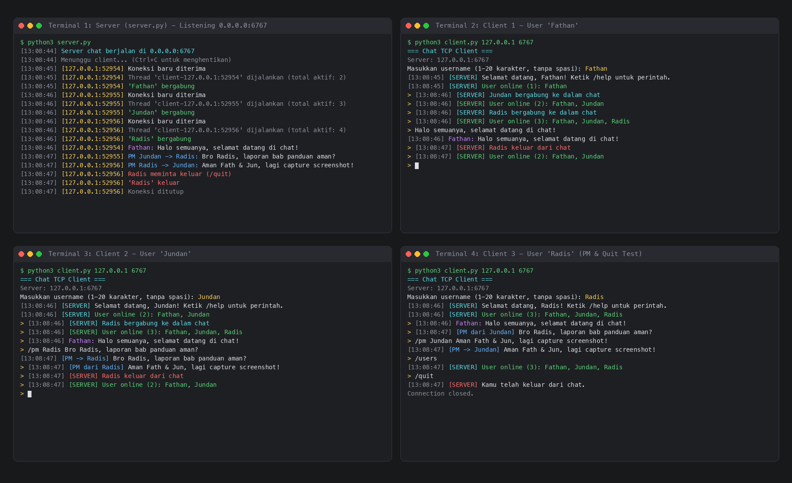

# Panduan Instalasi dan Penggunaan (User & Deployment Guide)
## Aplikasi Chat TCP Multi-Client Terminal

---

## 1. Prasyarat Perangkat Lunak dan Lingkungan

Aplikasi ini dirancang menggunakan pustaka standar (*standard library*) Python 3 tanpa ketergantungan library pihak ketiga (*zero third-party dependencies*).

### Spesifikasi Sistem
- **Sistem Operasi**: Linux, macOS, atau Windows.
- **Bahasa Pemrograman / Runtime**: Python 3.8 atau versi lebih baru.
- **Pustaka Python**: Modul bawaan standard library:
  - `socket`: Pengelolaan koneksi jaringan TCP (`AF_INET`, `SOCK_STREAM`).
  - `threading`: Konkurensi multi-thread untuk menangani banyak client sekaligus.
  - `json`: Serialisasi dan deserialisasi protokol pertukaran data berbasis teks JSON.
  - `time`: Pembuatan timestamp waktu lokal pesan (`HH:MM:SS`).
  - `sys`: Manipulasi I/O terminal dan argumen baris perintah (`sys.argv`).
  - `errno`: Penanganan kode error socket jaringan tingkat OS.
- **Kebutuhan Jaringan**:
  - Port TCP `6767` terbuka (atau port kustom yang disepakati).
  - Akses jaringan lokal (LAN/WLAN) jika dijalankan pada beberapa komputer fisik berbeda.

---

## 2. Langkah-Langkah Instalasi dan Konfigurasi

### Langkah 1: Kloning Repositori
Buka terminal dan unduh kode sumber dari repositori GitHub:
```bash
git clone https://github.com/Fathzzzzz/OHMayJarkomz.git
cd OHMayJarkomz
```

### Langkah 2: Verifikasi Integritas Berkas
Pastikan berkas-berkas utama tersedia di dalam direktori kerja:
- `server.py`: Program server pengelola socket dan thread client.
- `client.py`: Program client terminal antarmuka pengguna.
- `protocol.md`: Spesifikasi format pertukaran data JSON.
- `README.md`: Dokumentasi umum proyek.

---

## 3. Prosedur Menjalankan Server dan Client

### A. Menjalankan Server
Server harus dijalankan terlebih dahulu sebelum client mencoba terhubung.

1. Buka terminal baru.
2. Masuk ke direktori repositori:
   ```bash
   cd OHMayJarkomz
   ```
3. Eksekusi server:
   ```bash
   python3 server.py
   ```
4. Output terminal server akan menampilkan:
   ```text
   [HH:MM:SS] Server chat berjalan di 0.0.0.0:6767
   [HH:MM:SS] Menunggu client... (Ctrl+C untuk menghentikan)
   ```
   *Catatan:* Bind ke `0.0.0.0` memungkinkan server menerima koneksi dari interface lokal (*loopback*) maupun IP jaringan lokal (*LAN*).

---

### B. Menjalankan Client

Program client dapat dijalankan pada komputer yang sama (*localhost*) maupun komputer berbeda dalam satu jaringan.

#### Skenario 1: Satu Komputer (Localhost)
Buka terminal baru untuk setiap pengguna:
```bash
python3 client.py
```
*Secara default program langsung mengarah ke `127.0.0.1:6767`.*

#### Skenario 2: Komputer Berbeda (Jaringan LAN / Wi-Fi)
1. Periksa alamat IP komputer server (misal melalui `ip a` di Linux atau `ipconfig` di Windows atau `ifconfig` di macOS). Misal: `192.168.1.50`.
2. Pastikan firewall komputer server mengizinkan koneksi masuk (*inbound*) pada port `6767`.
3. Jalankan client pada komputer lain dengan menyertakan argumen IP dan port:
   ```bash
   python3 client.py 192.168.1.50 6767
   ```

---

### C. Panduan Input dan Perintah Client

Saat client dijalankan:
1. Masukkan **username** ketika diminta (`1–20 karakter`, `tanpa spasi`, `tidak diawali tanda /`).
2. Setelah username diverifikasi server, antarmuka chat aktif.

#### Daftar Perintah Tersedia:
| Perintah / Format | Fungsi | Contoh Penggunaan |
|---|---|---|
| `<teks pesan>` | Mengirim pesan publik ke seluruh client aktif (*broadcast*) | `Halo rekan-rekan semua` |
| `/pm <username> <pesan>` | Mengirim pesan privat ke satu pengguna tertentu | `/pm Jundan tolong periksa berkas` |
| `/users` | Menampilkan daftar seluruh pengguna yang sedang online | `/users` |
| `/help` | Menampilkan panduan bantuan perintah di terminal | `/help` |
| `/quit` atau `/exit` | Menutup sesi chat dan memutuskan koneksi secara bersih | `/quit` |

---

## 4. Pengujian Sistem Multi-Client

Pengujian dilakukan untuk memvalidasi kemampuan konkurensi server dalam melayani beberapa client secara simultan (*multi-threading*).

### Skenario Pengujian:
1. **Inisialisasi Server**: Server dijalankan pada port `6767`.
2. **Koneksi Multi-Client**: Tiga client bergabung secara berurutan: `Fathan`, `Jundan`, dan `Radis`.
3. **Pesan Publik (Broadcast)**: Pengguna `Fathan` mengirimkan pesan umum. Pesan diterima serentak oleh seluruh client (`Fathan`, `Jundan`, dan `Radis`).
4. **Pesan Pribadi (Private Message / PM)**: 
   - Pengguna `Jundan` mengirim pesan privat ke `Radis` via `/pm Radis ...`.
   - Pesan hanya diterima oleh `Radis` dan konfirmasi pengiriman `[PM -> Radis]` muncul di terminal `Jundan`. Sesi `Fathan` terisolasi dan tidak menerima pesan tersebut.
   - Pengguna `Radis` membalas secara privat ke `Jundan`.
5. **Pemeriksaan User Online**: Pengguna `Radis` mengeksekusi `/users` dan memperoleh daftar pengguna aktif terkini.
6. **Graceful Disconnect**: Pengguna `Radis` mengeksekusi `/quit`.
   - Thread client `Radis` dibersihkan dan socket ditutup.
   - Server mempublikasikan notifikasi leave ke client tersisa (`Fathan` dan `Jundan`).
   - Server tetap beroperasi normal melayani client yang masih terhubung.

---

### Screenshot Hasil Pengujian
Berikut adalah rekaman visual pengujian 4 terminal aktif secara bersamaan (1 Server dan 3 Client):



*Keterangan Gambar:*
- **Terminal 1 (Kiri Atas)**: Log aktivitas daemon server, pencatatan thread worker, alamat IP socket client, rute pesan publik, dan rute pesan pribadi.
- **Terminal 2 (Kanan Atas)**: Client 1 (`Fathan`) menerima notifikasi kehadiran client lain dan pesan siaran publik.
- **Terminal 3 (Kiri Bawah)**: Client 2 (`Jundan`) melakukan komunikasi dua arah privat dengan `Radis`.
- **Terminal 4 (Kanan Bawah)**: Client 3 (`Radis`) menerima PM, membalas PM, mengecek daftar user online, dan keluar menggunakan `/quit`.
